# Eiffel Graphing Calculator (simple_graph_calc)

A scientific graphing calculator written in Eiffel on **simple_gui**: one program, unchanged, on all three platforms. It is a native application on Linux (GTK 4) and macOS (AppKit), and on Windows it runs over simple_widgets (simple_gui's Windows backend, the Cairo look). It is the showcase and test bed for simple_gui.

- **Expressions** parsed by a grammar generated with Gobo's geyacc (`grammar/gc_parser.y`): implicit multiplication (`2x`, `3sin(x)`), `^`, `²`, `√`, `·`, `×`, `−`, π and e, and one variable of any name, including Greek (θ, α, λ).
- **Maths** from simple_math (functions, root bisection) and simple_calculus (derivative, integral).
- **Graphs** drawn with simple_cairo on a native canvas: pan with the arrow keys or the mouse, zoom with + and −.
- **Analysis** (f′(x₀), ∫ from a to b, roots) runs on a SCOOP worker, so the window stays responsive.

Status: 0.1. On Linux (GTK 4, WSLg), macOS (AppKit) and Windows (simple_widgets) all 19 tests pass: 7 for the grammar, 12 for a scripted session through simple_gui's test driver that plots, analyses on the worker, zooms, opens the table window, exports a PNG, saves and reopens a session, and switches to dark and to the Hebrew interface. The pictures below come from that session, on each platform.

| | Linux (GTK 4) | macOS (AppKit) | Windows (simple_widgets) |
|---|---|---|---|
| Light, with analysis | 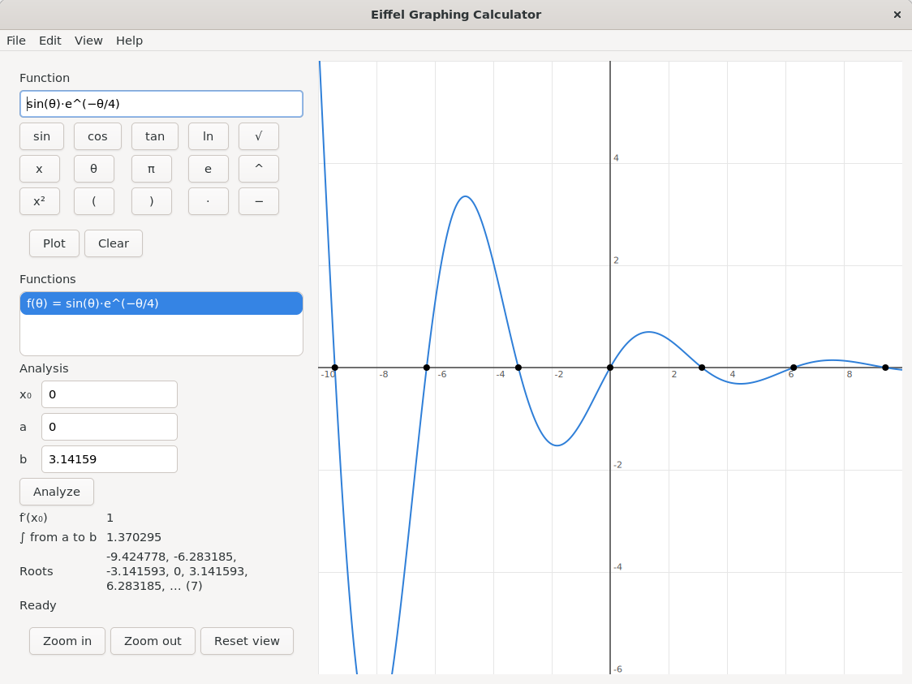 | 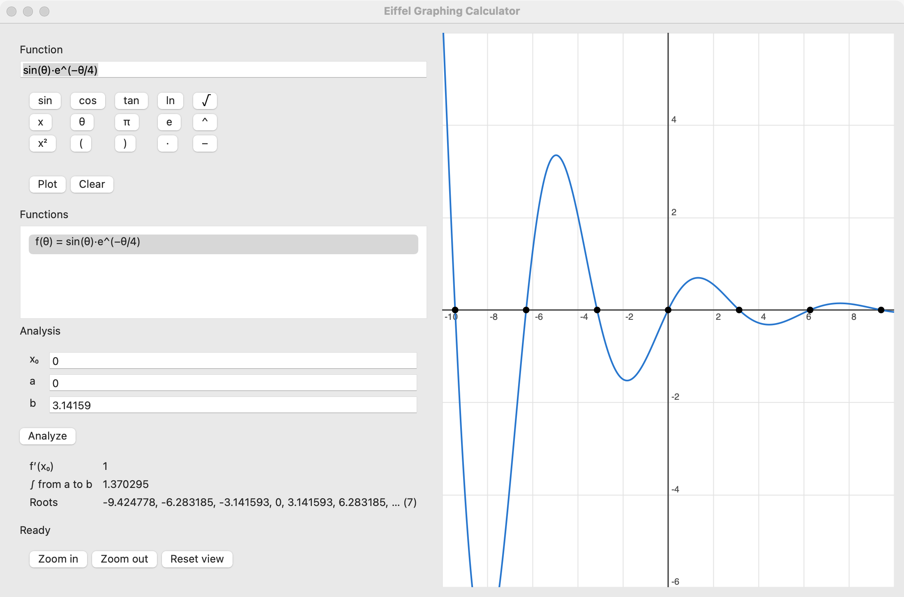 | 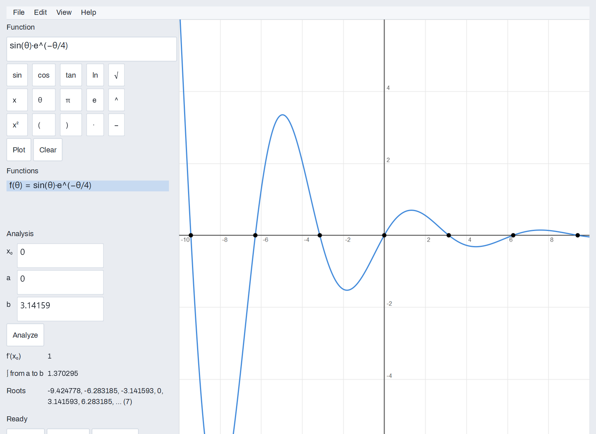 |
| Dark, two functions | 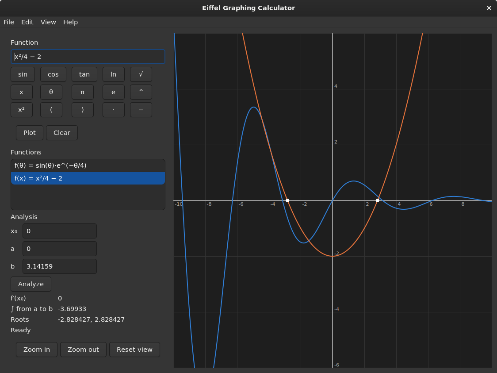 | 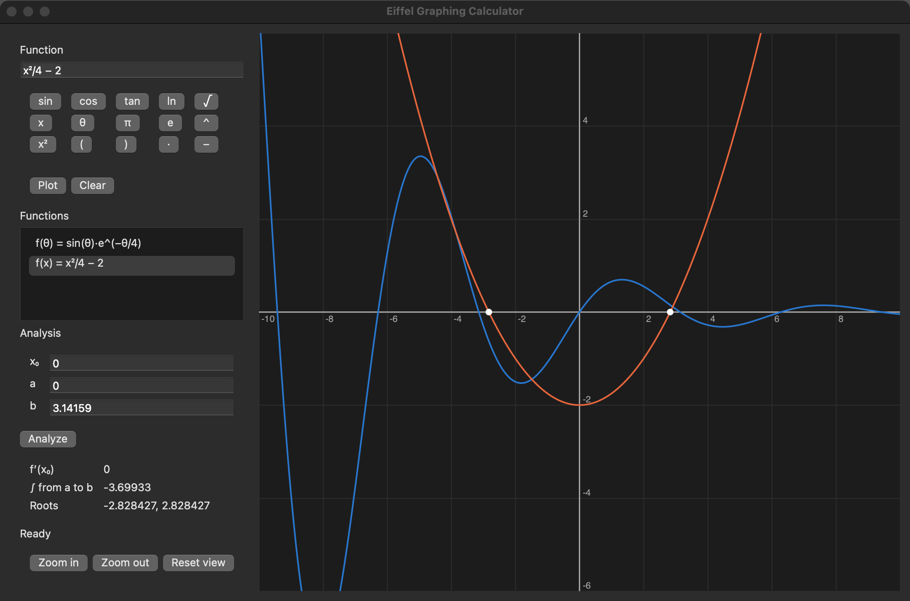 | 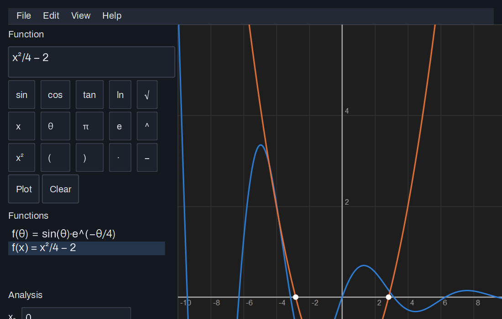 |
| Hebrew interface (mirrored) | 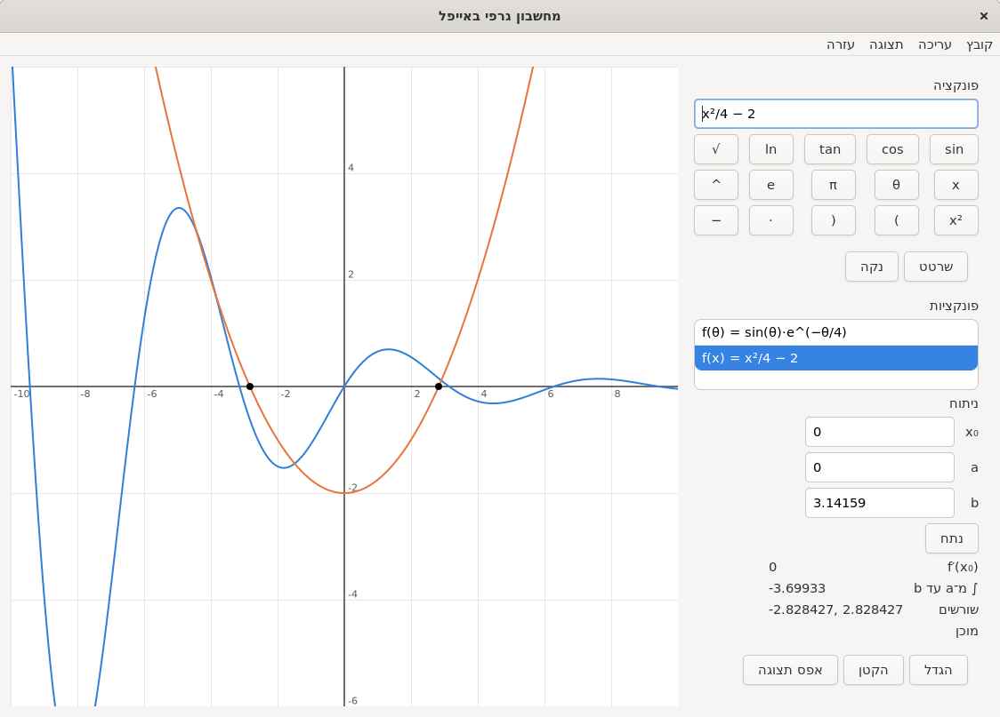 | 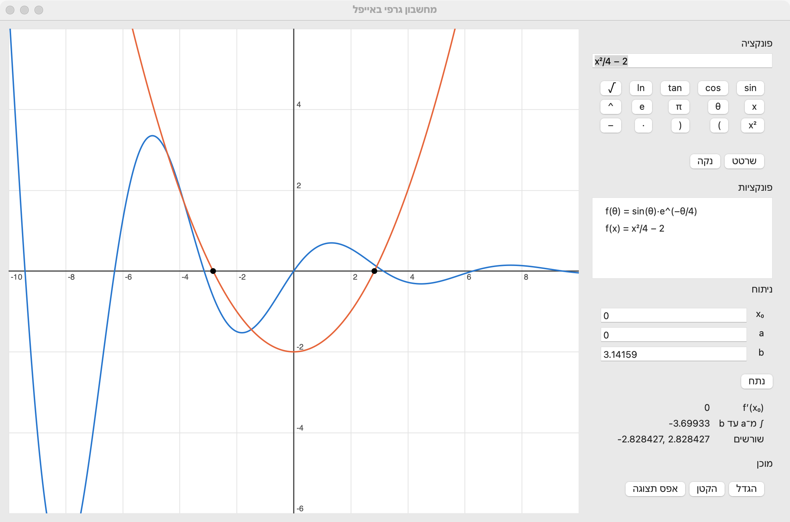 | 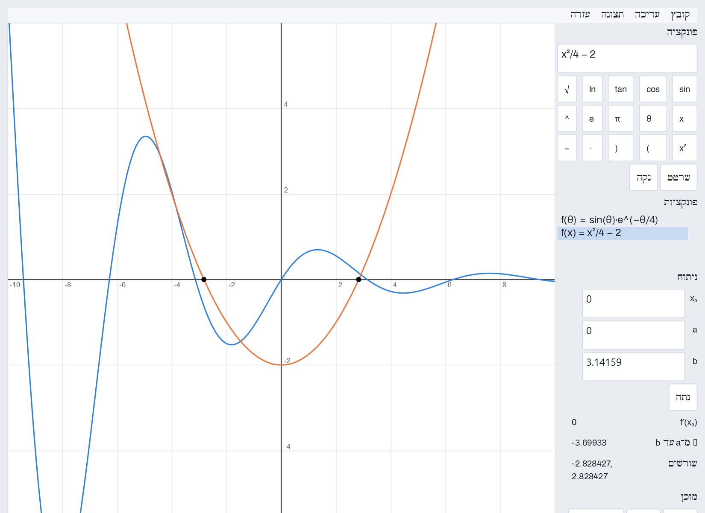 |
| Table of values | 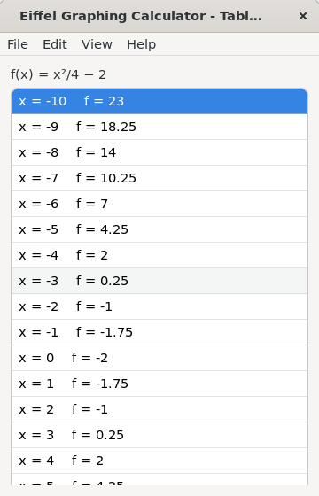 | 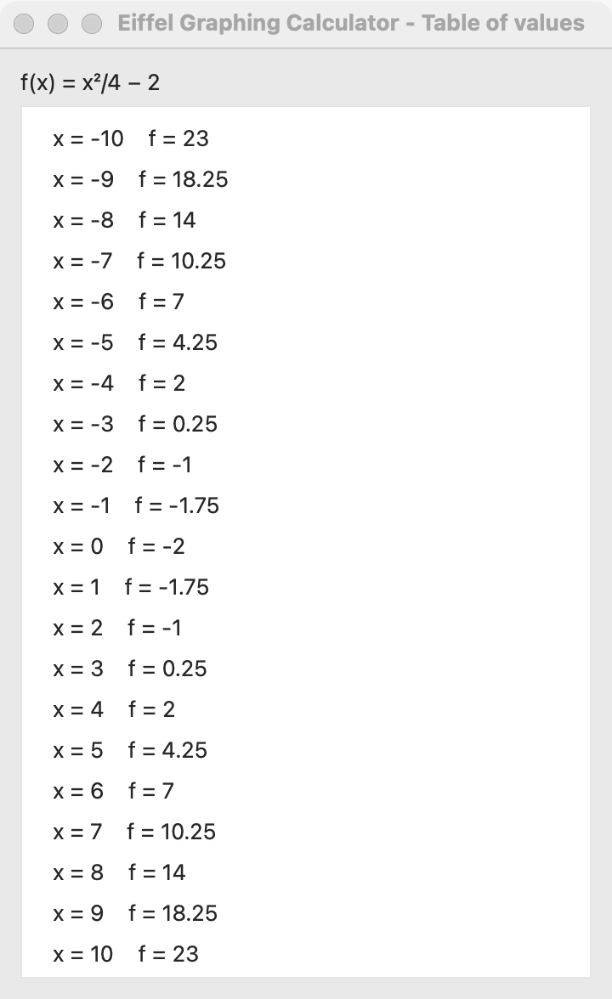 | 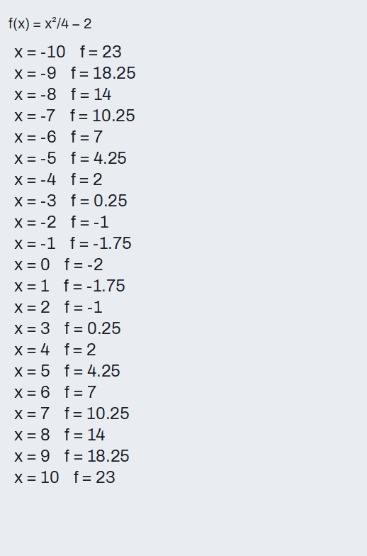 |

On macOS the menus are in the system menu bar, so they do not appear in the window pictures. The Hebrew interface translates the menus too; the Hebrew wording is machine-written.

On Windows the window keeps the size the program asks for (GTK and AppKit grow a window to fit its content), so the lower part of the analysis panel is cut off in these pictures; the table window opens as a window of its own beside the main one.

## A Mac application

To open the calculator from Finder, the Dock or Spotlight, finalize the `simple_graph_calc` target and wrap it in an app bundle:

```
ec -batch -config simple_graph_calc.ecf -target simple_graph_calc -finalize -c_compile
sh scripts/make_macos_app.sh EIFGENs/simple_graph_calc/F_code/simple_graph_calc
open "dist/Eiffel Graphing Calculator.app"
```

That `ec` line finalizes without contracts, which is what an application for people to use wants; the test builds keep their contracts. `ec` can also exit 0 when its C step fails, so check that the executable it names exists before running the script.

The script uses only tools that ship with macOS. It writes `Info.plist` (named "Eiffel Graphing Calculator", bundle id `org.simple-eiffel.graph-calc`, English and Hebrew), builds the icon from `packaging/macos/app_icon_1024.png`, copies the libraries the calculator needs from outside the system (Homebrew's cairo and the 15 libraries it pulls in) into `Contents/Frameworks` and points the app at those copies (`scripts/bundle_macos_libraries.sh`), and signs everything ad hoc, which Apple silicon requires. The app is about 8 MB and runs on a Mac without Homebrew. It is not signed with a Developer ID or notarized, and will not be: build it from source on your own Mac, as above. A copy carried to another Mac opens through Gatekeeper's "Open anyway" (System Settings, Privacy & Security) the first time.

## A Windows application

To run the calculator as an ordinary Windows program, finalize the `simple_graph_calc` target (not the tests target) and put it in `bin\` with the one DLL it needs:

```
ec.sh release -config simple_graph_calc.ecf -target simple_graph_calc
mkdir -p bin
cp EIFGENs/simple_graph_calc/F_code/simple_graph_calc_lean.exe bin/simple_graph_calc.exe
cp $SIMPLE_EIFFEL/simple_cairo/cairo.dll bin/
```

`ec.sh release` builds two executables: `simple_graph_calc_lean.exe` without contracts, which is the application for people to use, and `simple_graph_calc_dbc.exe` with them, for chasing a problem. As on the Mac, check that the executable exists before copying: `ec` can exit 0 when its C step fails.

Then double-click `bin\simple_graph_calc.exe`. It needs nothing else at run time: `cairo.dll` (from simple_cairo) beside it, and otherwise only DLLs that ship with Windows. There is no Visual C++ runtime to install. `bin\` is not committed (it is in `.gitignore`), so build it yourself after cloning.

The shortcuts use Ctrl (Ctrl+O, S, E, Q; Ctrl+R resets the view and Ctrl+T opens the table), the menu bar sits inside the window, and light and dark follow the Windows setting.

**Known limit on Windows:** the window keeps the size the program asks for (GTK and AppKit grow a window to fit its content), so the lower part of the analysis panel is cut off.

**Not yet checked by hand on Windows.** These are expected to work, from the code and from the shared tests, but nobody has tried them yet by hand:
- the Ctrl shortcuts listed above (the menus declare them as "primary" shortcuts, and primary is Ctrl on Windows);
- the Edit menu (Undo, Redo, Cut, Copy, Paste, Select All) in the text fields;
- switching between light and dark while the calculator is open (it follows the Windows setting at launch, and the shared test `system_colors_follow_the_appearance` passes);
- PNG export at 125 % and 150 % display scaling (checked at 100 % only);
- redrawing the graph while a window edge is being dragged.

**Found in the code, on every platform, not yet confirmed by a run:** the Table of values refreshes after zoom, Reset view and choosing another function, but not after panning with the arrow keys or the mouse, which only redraw the graph.

## Regenerating the parser

The generated `src/expression/gc_parser.e` is committed; you only need geyacc if you change the grammar:

```
sh scripts/generate_parser.sh
```

Keep the grammar ASCII (geyacc 22.01 re-encodes UTF-8); write characters as `'%/8730/'`.
